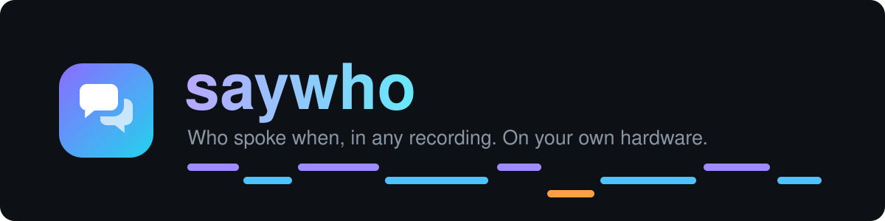
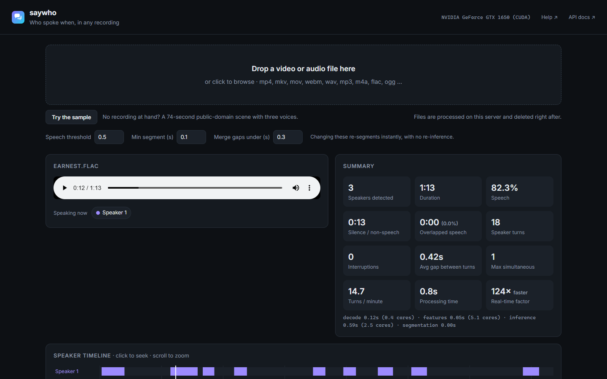

<p align="center"></p>

<p align="center">
  <b>Who spoke when, in any recording.</b><br>
  Drop in a meeting, interview or podcast and get each speaker's turns, talk time and subtitles.<br>
  Runs on your own machine: an NVIDIA GPU, a Rockchip NPU board, a Mac or any plain CPU.
</p>

<p align="center">
  <a href="https://github.com/anand34577/saywho/actions/workflows/tests.yml"></a>
  <a href="https://github.com/anand34577/saywho/actions/workflows/docker.yml"></a>
  <a href="https://github.com/anand34577/saywho/releases/latest"></a>
  <a href="LICENSE"></a>
</p>

<p align="center"></p>

---

saywho does **speaker diarization**: it listens to a recording and works out where each person is talking. It
doesn't transcribe the words or identify who people are. It labels them Speaker 1, Speaker 2 and so on, in the order
they first speak, and you can rename them in the app.

- **Any audio or video file**: mp4, mkv, mov, webm, wav, mp3, m4a, flac, ogg and anything else FFmpeg reads.
- **A clear picture of the conversation**: a timeline you can click to jump around, talk time per person, overlaps,
  interruptions, and who tends to answer whom.
- **Exports**: subtitles (SRT), spreadsheet (CSV), RTTM for research tools, and JSON.
- **A REST API** for your own apps, with a queue for long files and interactive docs at `/docs`.
- **Private by design**: everything runs on your machine. Uploads are deleted as soon as they are processed, and
  nothing is sent anywhere.
- **Uses the hardware you have**, picking the fastest option on its own and falling back to the CPU if a driver is
  missing.

| Hardware | Speed on a 74-second recording |
|---|---|
| NVIDIA GPU (tested on a 4 GB GTX 1650) | about 130x real time: an hour of audio in about 30 seconds |
| Any 64-bit CPU (tested on a 6-core Ryzen 5 laptop) | about 35x real time: an hour of audio in under 2 minutes |
| Rockchip RK3566 / RK3568 / RK3576 / RK3588 NPU | runs on the NPU, with the CPU free for other work |
| Apple Silicon Mac | uses the Mac's GPU |

Under the hood saywho runs [Nemotron-3-Diarization](https://huggingface.co/nvidia/Nemotron-3-Diarization), an open
model from NVIDIA that handles up to 8 speakers.

## Get started

**Step-by-step guides for every system are in the [wiki](https://github.com/anand34577/saywho/wiki)**, written so
that you don't need to be a developer to follow them.

The quickest way is Docker. Pick the line that matches your machine:

```bash
# Any computer (Windows, Mac, Linux; Intel, AMD or ARM)
docker run -d --name saywho -p 7860:7860 --restart unless-stopped ghcr.io/anand34577/saywho:cpu

# Computer with an NVIDIA graphics card (needs the NVIDIA Container Toolkit)
docker run -d --name saywho -p 7860:7860 --restart unless-stopped --gpus all ghcr.io/anand34577/saywho:cuda

# Rockchip RK3566/68/76/88 board. RKNN_ACCEPT_LICENSE=yes accepts Rockchip's license for its NPU runtime
docker run -d --name saywho -p 7860:7860 --restart unless-stopped --privileged \
  -e RKNN_ACCEPT_LICENSE=yes -v rknn-runtime:/opt/rknn ghcr.io/anand34577/saywho:rknn
```

Then open **<http://localhost:7860>** and click **Try the sample**, or drop in a file of your own. The first start
takes up to a minute while the model loads.

Prefer not to use Docker? Download the code (the green **Code** button, then **Download ZIP**), unpack it, and run
the installer. It sets up Python packages, picks the right build for your graphics card and checks that everything
works.

| System | Install | Start |
|---|---|---|
| Windows 10/11 with [Python 3.10-3.13](https://www.python.org/downloads/) | double-click `install.bat` | double-click `run.bat` |
| Linux or macOS | `./install.sh` | `./run.sh` |
| Rockchip board | `./install.sh rknn` | `./run.sh` |

## Use it from your own code

```bash
curl -F file=@meeting.mp4 http://localhost:7860/api/v1/diarize                          # JSON result
curl -F file=@meeting.mp4 -F format=srt -o meeting.srt http://localhost:7860/api/v1/diarize   # subtitles
```

```json
{
  "duration": 73.6, "num_speakers": 3, "accelerator": "NVIDIA GeForce GTX 1650 (CUDA)",
  "speakers": [{"label": "Speaker 1", "talk_time": 23.8, "share_of_speech": 0.393, "segments": 9}],
  "segments": [{"speaker": "Speaker 1", "start": 0.3, "end": 4.0, "duration": 3.71, "overlaps_with": []}],
  "summary": {"speech_time": 60.6, "overlap_time": 0.0, "speaker_turns": 18, "interruptions": 0}
}
```

Long files can go through the job queue (`POST /api/v1/jobs`, then poll). You can protect the API with a key, allow
other websites to call it, and limit upload sizes. Everything is in the [API reference](docs/API.md), and there is
a ready-made [Python client](examples/client.py).

## Documentation

| I want to... | Read |
|---|---|
| Install it, step by step | [Wiki: Getting started](https://github.com/anand34577/saywho/wiki) |
| Understand the results | [Wiki: Reading the results](https://github.com/anand34577/saywho/wiki/Reading-the-results) |
| Change a setting | [Wiki: Settings](https://github.com/anand34577/saywho/wiki/Settings) and [.env.example](.env.example) |
| Fix a problem | [Wiki: Troubleshooting](https://github.com/anand34577/saywho/wiki/Troubleshooting) |
| Run it with Docker or Compose | [docs/DOCKER.md](docs/DOCKER.md) |
| Run it on a server, behind HTTPS, as a service | [docs/DEPLOYMENT.md](docs/DEPLOYMENT.md) |
| Call the API | [docs/API.md](docs/API.md) |
| Help develop it | [CONTRIBUTING.md](CONTRIBUTING.md) |

## Use recordings responsibly

Recordings of people's voices are personal data in many countries (for example under the GDPR). Only process
recordings you are allowed to process, get consent where the law asks for it, and follow the recording and privacy
laws that apply to you. saywho labels speakers by order of appearance. It does not and should not be used to
identify who a person is.

Results can contain mistakes, especially with more than eight speakers (the model's limit), noisy audio or very
short turns. Check them before you rely on them for decisions about people. The software and the model are provided
"as is", without warranty of any kind.

## License and credits

- **saywho's code** is under the [Apache License 2.0](LICENSE). See [NOTICE](NOTICE).
- **The model** [nvidia/Nemotron-3-Diarization](https://huggingface.co/nvidia/Nemotron-3-Diarization) by NVIDIA,
  and the Rockchip versions converted from it, are under the [OpenMDW License 1.1](licenses/OpenMDW-1.1.txt).
  Commercial and non-commercial use are both allowed. If you pass the model on, include that license.
- **The Rockchip NPU runtime** is Rockchip's own software under its
  [RKNN SDK License](https://github.com/airockchip/rknn-toolkit2/blob/master/LICENSE). saywho does not ship it; it
  is downloaded from Rockchip only after you accept that license.
- **The Docker images** also contain Debian, FFmpeg, PyTorch, Python packages and, in the `cuda` image, NVIDIA CUDA
  libraries, each under its own license. See [THIRD_PARTY_NOTICES.md](THIRD_PARTY_NOTICES.md) and `/licenses`
  inside each image.
- **The sample recording** is a public-domain excerpt from LibriVox; see [samples/README.md](samples/README.md).

NVIDIA, Nemotron and CUDA are trademarks of NVIDIA Corporation. Rockchip and RKNN are trademarks of Rockchip
Electronics Co., Ltd. saywho is an independent project, not affiliated with or endorsed by either company.
